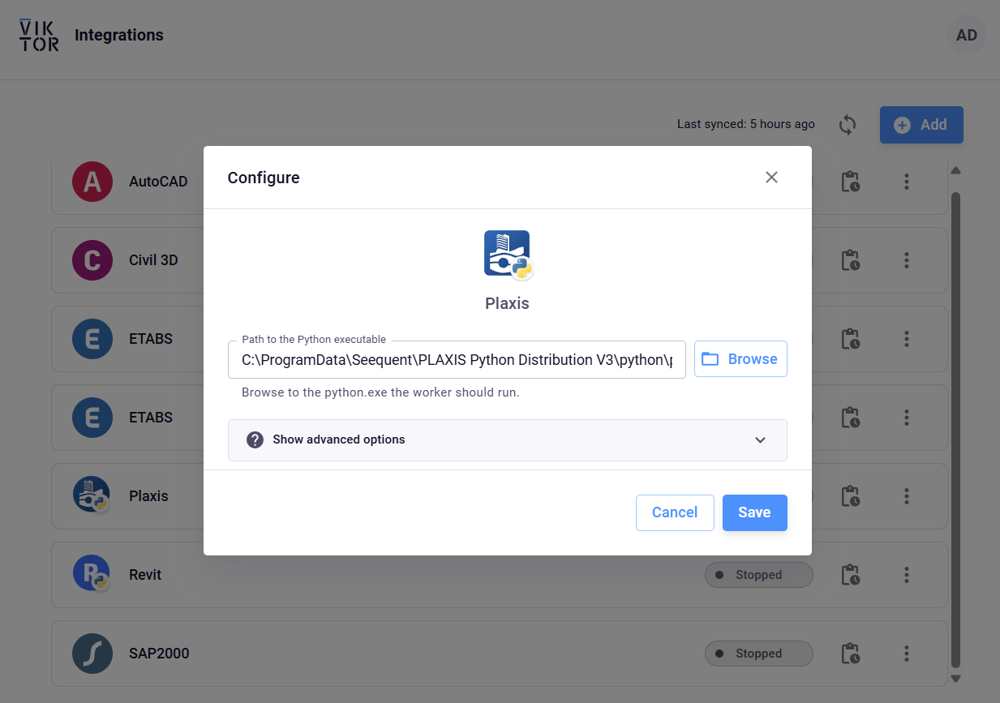
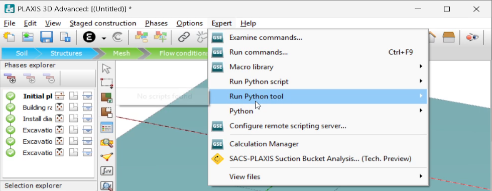
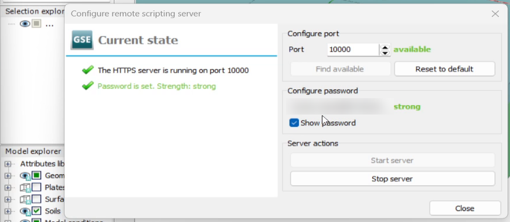
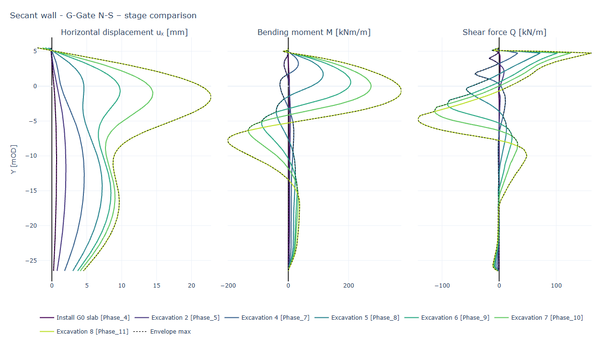
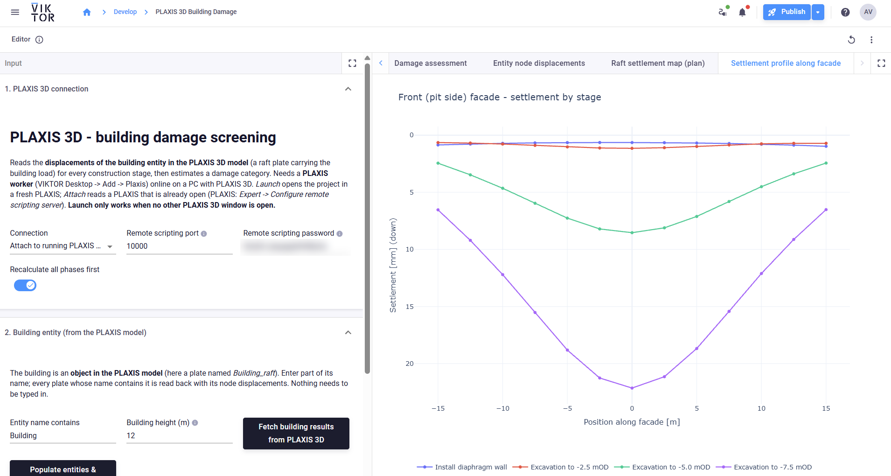

# PLAXIS sample apps

Two VIKTOR apps that read live results from **PLAXIS** through a VIKTOR PLAXIS worker running on your own PC, then plot and assess them in the browser.

| App | Folder |
|---|---|
| PLAXIS 2D wall results | [`plaxis-2d-wall-results`](plaxis-2d-wall-results) |
| PLAXIS 3D building damage | [`plaxis-3d-building-damage`](plaxis-3d-building-damage) |

---

## 1. Set up the PLAXIS worker (once)

Needs a Windows PC with PLAXIS 2D / 3D 2026 and VIKTOR Desktop.

1. VIKTOR Desktop → **Integrations** → **Add** → **Plaxis**.
2. **Path to the Python executable**: the Python that ships with PLAXIS (it contains `plxscripting` ≥ 1.0.10, needed for PLAXIS 2026):

   ```
   C:\ProgramData\Seequent\PLAXIS Python Distribution V3\python\python.exe
   ```

3. **Save** and start the worker (status *Running*).



> Do not use your system Python: its `plxscripting` is usually too old for the PLAXIS 2026 HTTPS server.

## 2. Run an app

```
cd plaxis-2d-wall-results      # or plaxis-3d-building-damage
viktor-cli clean-start
```

Change `registered_name` in `viktor.config.toml` to your own app name first.

## 3. Connect to PLAXIS

Both apps have two modes:

- **Launch**: the worker starts PLAXIS and opens the project. Set the `.p2dx` / `.p3d` path (3D: no other PLAXIS 3D window may be open).
- **Attach**: use a PLAXIS that is already open.
  1. In PLAXIS: **Expert → Configure remote scripting server**.

     

  2. Note the **port**, set a **password** (tick *Show password* to read it) and make sure the server is running (**Start server** if not).

     

  3. In the app: choose *Attach*, enter the port and password. The PLAXIS title bar shows `HTTPS SERVER ACTIVE on port ...` when the server is on.

Accept the PLAXIS disclaimer once on the PC ("Do not show again"), otherwise the worker waits for a click.

---

## PLAXIS 2D wall results

**App name:** `plaxis-wall-results` · **Folder:** [`plaxis-2d-wall-results`](plaxis-2d-wall-results)

Reads the bending moment, shear force and horizontal displacement of a retaining wall for every construction stage. Plot one stage, compare stages (with max/min envelope), see a summary table and download a CSV.



**How to use**

1. Section *PLAXIS connection*: choose Launch or Attach (see above) and set the project path or port/password.
2. Click **Fetch results from PLAXIS**.
3. Section *What to plot*: choose the **Wall**, **Stage** and **Stages to compare**. If the lists are empty click **Populate walls & stages from results**.
4. Open the views: *Wall at one stage*, *Compare stages*, *Summary per stage*.

`model_scripts/` contains the scripts that build the demo model in PLAXIS 2D.

---

## PLAXIS 3D building damage

**App name:** `plaxis-3d-damage` · **Folder:** [`plaxis-3d-building-damage`](plaxis-3d-building-damage)

Reads the displacements of a building entity (a raft plate) from a PLAXIS 3D excavation model for every construction stage, then estimates an indicative damage category (Burland / Boscardin & Cording). Views: 3D scene, damage assessment, node displacements, raft settlement map and facade settlement profile.



**How to use**

1. Section *1. PLAXIS 3D connection*: choose Launch or Attach and set the project path or port/password.
2. Section *2. Building entity*: keep **Entity name contains** = `Building` (matches the plate `Building_raft`), set the building height.
3. Click **Fetch building results from PLAXIS 3D**.
4. Section *3. Assessment*: choose the **Building entity**, **Construction stage**, building type and facade. If the lists are empty click **Populate entities & stages from stored results**.

---

## Notes

- The PLAXIS model files are not included (size). Point the project path to your own `.p2dx` / `.p3d`.
- Tests: `viktor-cli install`, then `viktor-cli test` (uses saved worker output, no PLAXIS needed).
- The remote scripting password is sent to the worker for that job only.
